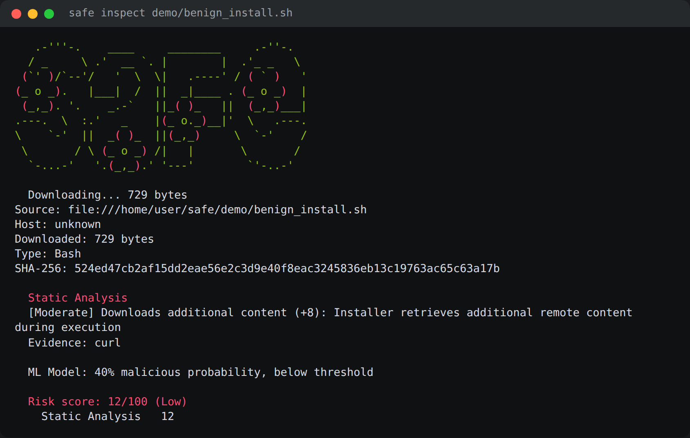
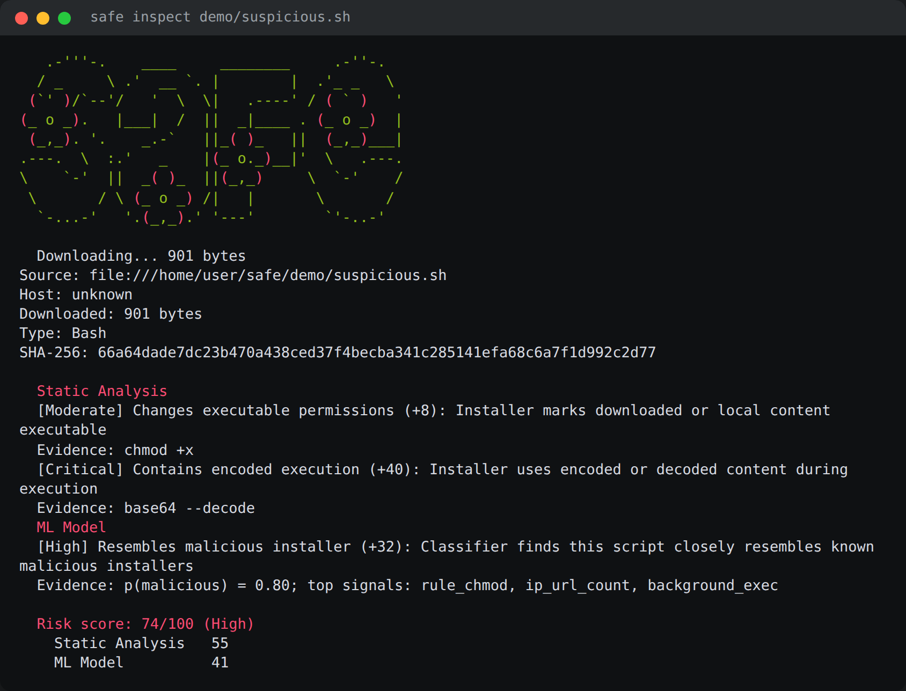

# SafeInstall

[](https://crates.io/crates/safeinstall)
[](LICENSE)


[Why](#why) • [Features](#features) • [Install](#install) • [Usage](#usage) • [Commands](#commands) • [How it works](#how-it-works) • [Configuration](#configuration) • [FAQ](#faq) • [Development](#development)

```
   .-'''-.    ____     ________     .-''-.  .-./`) ,---.   .--.   .-'''-. ,---------.    ____      .---.     .---.
  / _     \ .'  __ `. |        |  .'_ _   \ \ .-.')|    \  |  |  / _     \\          \ .'  __ `.   | ,_|     | ,_|
 (`' )/`--'/   '  \  \|   .----' / ( ` )   '/ `-' \|  ,  \ |  | (`' )/`--' `--.  ,---'/   '  \  \,-./  )   ,-./  )
(_ o _).   |___|  /  ||  _|____ . (_ o _)  | `-'`"`|  |\_\|  |(_ o _).       |   \   |___|  /  |\  '_ '`) \  '_ '`)
 (_,_). '.    _.-`   ||_( )_   ||  (_,_)___| .---. |  _( )_\  | (_,_). '.     :_ _:      _.-`   | > (_)  )  > (_)  )
.---.  \  :.'   _    |(_ o._)__|'  \   .---. |   | | (_ o _)  |.---.  \  :    (_I_)   .'   _    |(  .  .-' (  .  .-'
\    `-'  ||  _( )_  ||(_,_)     \  `-'    / |   | |  (_,_)\  |\    `-'  |   (_(=)_)  |  _( )_  | `-'`-'|___`-'`-'|___
 \       / \ (_ o _) /|   |       \       /  |   | |  |    |  | \       /     (_I_)   \ (_ o _) /  |        \|        \
  `-...-'   '.(_,_).' '---'        `'-..-'   '---' '--'    '--'  `-...-'      '---'    '.(_,_).'   `--------``--------`
```

SafeInstall inspects remote installer scripts before executing them. It downloads the artifact, runs static analysis, checks against vulnerability databases and reputation sources, then decides whether it's safe to run.

https://github.com/user-attachments/assets/633bf111-6226-4e0b-8bcf-4d3e11054a28

## Why

`curl | sh` is how most tools install. The script is downloaded, piped to a shell, and executed in one step with zero inspection. If the CDN is compromised, the package is typo-squatted, or the release build is tampered with, you have already run it before any scanner could flag it. SafeInstall breaks that: it downloads the artifact, inspects it, checks it against vulnerability databases and malware feeds, then scores the risk before you decide to run.

## Features

- **Pre-execution analysis** - downloads and inspects before any code executes
- **Static behavior detection** - flags privilege escalation, persistence, and network exfiltration patterns
- **Vulnerability scanning** - queries OSV (CVE database) and GitHub Advisory Database
- **Multi-source reputation** - domain checks, URLHaus, VirusTotal, and Cloudflare Radar
- **Package manager support** - recognizes npm, pip, and cargo install commands
- **Energy-based scoring** - exponential saturation prevents score inflation from duplicate findings
- **Adaptive prompts** - `[Y/n]` for low risk, `[y/N]` for high risk, `-y` to skip
- **JSON output** - machine-readable for CI pipelines and automation
- **ML classifier** - a RandomForest trained on installer behavior adds a second, learned opinion alongside the hand-written rules

## Machine learning classifier

Static rules catch known-bad patterns one at a time. The ML classifier adds a second
opinion that weighs **57 behavioral features** of a script together — the same 10 rule
hits plus entropy, line statistics, URL/IP counts, base64 density, PowerShell obfuscation
signals, credential-access and anti-forensics markers, and the installer type — and returns
a calibrated `p(malicious)`. When it crosses the model's threshold it becomes an **ML Model**
finding that feeds the same energy-based risk score.

The model is a `RandomForest` trained offline (`ml/`) and exported to **pure Rust**
(`src/ml_model.rs`) with [`m2cgen`](https://github.com/BayesWitnesses/m2cgen). Inference is a
few thousand branch comparisons: no Python, no network, no model file to ship. Python and the
exported Rust agree on `p(malicious)` to within `5e-11`.

| Metric (held-out test set) | Value |
|---|---|
| Precision | 0.992 |
| Recall | 0.992 |
| F1 | 0.992 |
| ROC AUC | 0.999 |
| Threshold | 0.53 |

Feature extraction lives in `src/features.rs` and is exposed through a hidden
`safe features <file> --json` subcommand, so the training pipeline and the shipped binary
compute an identical representation. Pass `--no-ml` to `inspect`/`run` to skip the classifier.

Training data, methodology, and limitations are documented in [`ml/README.md`](ml/README.md).
The benign class is features of real installer scripts (rustup, nvm, Homebrew, Deno, Docker,
Helm, and dozens more); the malicious class is synthesized in **feature space** from documented
MITRE ATT&CK indicator distributions — no malware is stored, committed, or executed anywhere in
this repository.

<table>
<tr>
<td></td>
<td></td>
</tr>
</table>

## Install

<details open>
<summary><strong>From crates.io</strong></summary>

```sh
cargo install safeinstall
```

</details>

<details open>
<summary><strong>Build from source</strong></summary>

```sh
git clone https://github.com/forloopcodes/safeinstall.git
cd safeinstall
cargo build --release
```

The binary is placed at `target/release/safe.exe` (Windows) or `target/release/safe` (macOS/Linux).

</details>

### Prerequisites

- [Rust](https://rustup.rs) 1.85 or later
- A C compiler (for native dependency linking)

## Usage

### Inspect an installer without running it

```sh
safe inspect https://example.com/install.sh
safe inspect https://bun.sh/install
safe inspect https://example.com/setup.ps1 --json
```

### Run an installer after analysis

```sh
safe run "curl -fsSL https://example.com/install.sh | bash"
safe run "irm https://example.com/install.ps1 | iex"
safe run "npm install -g bun"
safe run "pip install requests" -y
safe run "cargo install ripgrep" -y
```

> [!TIP]
> The `-y` flag skips the confirmation prompt. For high or critical risk installers you still get a warning message, but execution proceeds.

### Configure API keys

```sh
safe set VIRUSTOTAL_API_KEY "your-key-here"
safe set CLOUDFLARE_API_TOKEN "your-token-here"
```

Keys are stored in the platform config directory and used for optional reputation lookups. Without them, analysis still covers static analysis, domain reputation, URLHaus, OSV, and GitHub Advisories.

## Commands

| Command | Description |
|---------|-------------|
| `inspect <source>` | Download and analyze, no execution. Add `--json` for machine output. |
| `run <command>` | Analyze then execute. Prompts for confirmation unless `-y` is passed. |
| `set <key> <value>` | Store an API key in the global config file. |

### Prompt defaults

The prompt adapts to the risk level found during analysis:

> **Low / Medium risk**: `[Y/n]` suggests proceeding. Press Enter to confirm.
>
> **High / Critical risk**: `[y/N]` requires an explicit "y" to proceed.

Pass `-y` or `--yes` to skip the prompt entirely.

## How it works

```
Input -> Command Parser -> Classify
                           ├── npm/pip/cargo install -> Package Registry -> GitHub API -> OSV + GH Advisories -> Scorecard
                           └── URL / curl-pipe / generic -> Download -> Static Analysis -> SHA-256 -> Reputation Checks
                                                                                              ├── Domain Reputation
                                                                                              ├── URLHaus
                                                                                              ├── OSV (CVE database)
                                                                                              ├── GitHub Advisories
                                                                                              ├── VirusTotal (if key set)
                                                                                              └── Cloudflare Radar (if token set)
```

Each finding contributes to an energy-based score (0-100). Scores are computed through exponential saturation so multiple findings have diminishing returns rather than linear stacking. Duplicate CVEs across sources are deduplicated to avoid double-counting.

## Configuration

API keys are stored in a JSON file in your platform config directory:

- **Windows**: `%APPDATA%\safeinstall\config.json`
- **Linux**: `~/.config/safeinstall/config.json`
- **macOS**: `~/Library/Application Support/safeinstall/config.json`

Use `safe set <key> <value>` to set them. Current keys:

- `VIRUSTOTAL_API_KEY` - VirusTotal file hash lookups
- `CLOUDFLARE_API_TOKEN` - Cloudflare Radar domain ranking

> [!NOTE]
> API keys are optional. All static analysis, OSV vulnerability scanning, domain reputation checks, and URLHaus lookups work without any configuration.

## FAQ

**Q: Does SafeInstall modify or run the installer during `inspect`?**  
A: No. `inspect` only downloads the artifact into memory and analyzes it. The bytes are never written to disk or executed.

**Q: What package managers are supported?**  
A: npm (and pnpm, yarn), pip, and cargo. Other package manager commands fall back to plain URL detection and analysis.

**Q: Can SafeInstall block everything automatically?**  
A: No. It scores the risk and prompts you. You make the final call. The only exception is Ctrl+C to abort.

**Q: What happens if I press Ctrl+C during a prompt?**  
A: The process prints "Exiting." and exits immediately.

**Q: Does SafeInstall upload my files or installer contents anywhere?**  
A: No. All analysis is local. The only network requests are downloading the installer and querying reputation APIs (OSV, URLHaus, VirusTotal, Cloudflare). File hashes are sent to VirusTotal if configured; no file contents are uploaded.

## Development

```sh
cargo test
cargo run -- inspect https://bun.sh/install
cargo run -- run "npm install -g openclaw" -y
```

### Project structure

```
src/
├── main.rs              # Entrypoint and CLI routing
├── cli.rs               # Subcommand definitions (clap)
├── command.rs           # Input classifier (URL, curl-pipe, package manager)
├── source.rs            # Downloader and installer type detection
├── analyzer.rs          # Static analysis rules and scoring engine
├── features.rs          # ML feature extraction (57 features, shared with ml/)
├── ml.rs                # Classifier inference and ML Model findings
├── ml_model.rs          # RandomForest exported to pure Rust (generated)
├── executor.rs          # Execution gates and interpreter dispatch
├── report.rs            # Terminal and JSON output formatting
├── config.rs            # Persistent config storage (API keys)
├── registry.rs          # Package registry lookups (npm, GitHub, Scorecard)
└── reputation/          # External threat intelligence providers
    ├── domain.rs        # Domain trust checks
    ├── urlhaus.rs       # URLHaus malware URL database
    ├── osv.rs           # Open Source Vulnerabilities (CVE database)
    ├── github_advisory.rs # GitHub Advisory Database
    ├── virustotal.rs    # VirusTotal file hash lookups
    └── cloudflare.rs    # Cloudflare Radar domain ranking
```

## Troubleshooting

**"command exited with status"** - The installer or command failed during execution. Check the output above the error for details.

**"Cancelled."** - You declined the confirmation prompt, or pressed Enter on a `[y/N]` prompt.

**"Installer exceeds the 20 MB analysis limit"** - The downloaded file is too large. SafeInstall caps analysis at 20 MB.

**No vulnerability results** - OSV and GitHub Advisory lookups require network access. If you're offline, only static analysis and cached reputation checks apply.

If this project helps you, star it on GitHub - it helps a lot!
