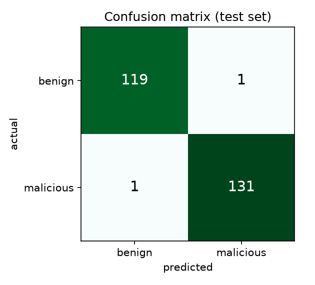
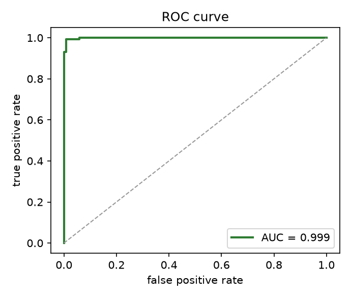
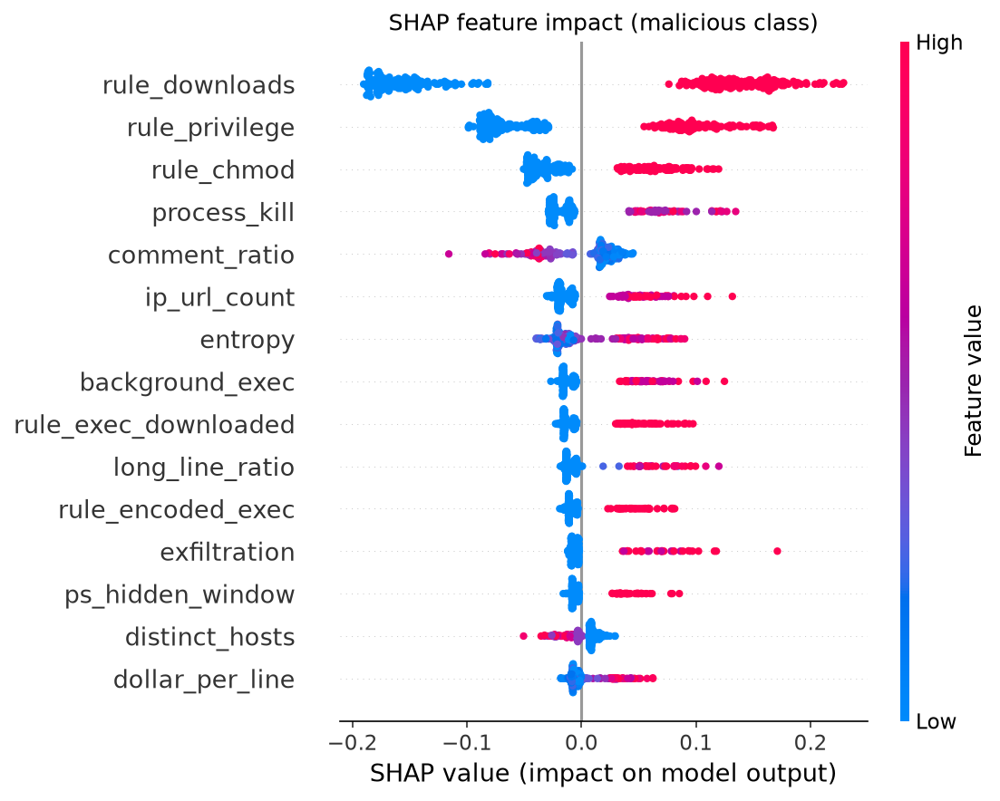

# SafeInstall ML pipeline

Trains the installer-malware classifier that powers the **ML Model** finding in the `safe`
CLI, and exports it to dependency-free Rust.

## Pipeline

```
fetch_benign.py  ──▶  corpus/benign/*        (real installer scripts, not committed)
                          │
build_dataset.py ──▶  data/features.csv      (safe features + synthesized malicious rows)
                          │
train.py         ──▶  src/ml_model.rs         (RandomForest exported via m2cgen)
                      ml/figures/*.png         (confusion matrix, ROC, SHAP)
                      data/model_report.json   (metrics + parity)
```

Reproduce end to end:

```sh
pip install -r ml/requirements.txt
cargo build --release
python ml/fetch_benign.py        # downloads official installers + harvests local system scripts
python ml/build_dataset.py       # writes data/features.csv
python ml/train.py               # trains, evaluates, exports src/ml_model.rs, checks parity
cargo test                       # feature/model tests, incl. Python↔Rust feature contract
```

`train.ipynb` is a notebook walkthrough of the same steps with inline plots.

## Features (57)

Extracted by `src/features.rs`, exposed via `safe features <file> --json`:

- **10 rule features** — one 0/1 per static analyzer rule (download-and-exec, privilege,
  persistence, registry, disable-security, encoded-exec, recursive-delete, …).
- **19 statistics** — log size / line counts, average and max line length, long-line ratio,
  Shannon entropy, comment/blank/non-ASCII/symbol ratios, `$` density, URL / HTTP-URL / IP-URL
  counts, distinct hosts, base64-token count, longest token, function count.
- **23 behavioral indicators** — hex escapes, char-code/string-concat/backtick obfuscation,
  PowerShell IEX / hidden-window / exec-bypass / download-cradle / reflection, reverse-shell,
  eval, anti-forensics, credential access, crypto-mining, exfiltration, temp-dir execution,
  background execution, file locking, process kill, user creation, ssh-key injection, checksum
  verification, usage/help text.
- **5 installer-kind one-hots** — bash, powershell, python, executable, text.

Counts are stored as `ln(1 + n)` so a few extra matches do not dominate. The Rust extractor
and the training pipeline share this exact order (enforced by tests).

## Dataset

| Class | Count | Source |
|---|---|---|
| Benign (0) | 480 | Features of real installer scripts: rustup, nvm, bun, Deno, Homebrew, Docker, Helm, k3s, pyenv, Starship, fnm, Volta, poetry, pip, SDKMAN, Tailscale, NodeSource, pnpm, mise, dotnet, PowerShell, chocolatey, vcpkg, Azure/AWS CLI, and local system `.sh`/`.ps1`/`.py`/`.cmd` scripts. |
| Malicious (1) | 528 | **Synthesized in feature space** from documented ATT&CK indicator distributions. |

### Why synthetic malicious data, and how it is kept honest

Distributing a corpus of working malware — even for training — is unsafe and against this
project's principles. Instead, each malicious row **borrows its structural features** (size,
line counts, comment ratio, interpreter kind, function count) from a real benign script, then
has one to three **attack archetypes** layered on (reverse shell, miner dropper, credential
theft, obfuscated PowerShell cradle, encoded stager, security tampering, backdoor account,
wiper, supply-chain trojan). An archetype turns on the detection indicators a documented
technique class exhibits and shifts the correlated byte-statistics (entropy, base64 density,
long-line ratio, hard-coded IP endpoints). See `synth_malicious.py`.

Because structural features are inherited from genuine installers, the classes are **not**
separable on length or interpreter alone — the signal lives in the behavioral indicators, which
the Rust extractor computes identically on real input. `safe`'s own hardest benign cases (rustup
and Homebrew use `sudo`, `curl | sh`, `chmod`, services, and PATH edits) are in the benign class,
so the model cannot shortcut on those.

**Limitation:** a synthetic positive class means reported metrics measure separability of the
*modeled* attack distribution, not field accuracy against live malware. Replacing the synthesis
step with a vetted, access-controlled real-malware feature corpus is the primary future-work
item. Nothing about the feature contract or the Rust export changes when that swap happens.

## Results

RandomForest and GradientBoosting were compared; GradientBoosting scored marginally higher
(F1 0.985 vs 0.974 at threshold 0.5) but only RandomForest exports to dependency-free Rust via
m2cgen, so it is the deployed model. At the selected operating threshold (0.53, chosen to keep
the benign false-positive rate under 2%):

| Metric | Value |
|---|---|
| Precision | 0.992 |
| Recall | 0.992 |
| F1 | 0.992 |
| ROC AUC | 0.999 |
| Python↔Rust parity (max abs diff) | 4.6e-11 |




